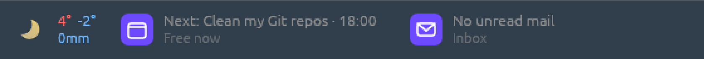

# BetterTaskbar

Small widgets that live in the empty space on your Windows 11 taskbar:
weather, your next calendar event, unread mail, and how much of your AI
coding plan is left. They sit on the bar with no background of their own,
so they match whatever color or effect your taskbar has.

[](https://github.com/mrk1987/bettertaskbar/actions/workflows/ci.yml)



If you, like me, use Proton Mail Bridge and my other project
[iOxide](https://github.com/mrk1987/iOxide), want a better weather widget with
data from Norway's sweetheart yr.no, and have an ultrawide monitor with unused
real estate on your taskbar, then you are in a very small niche. But also; I have 
just the thing for you!

## Widgets

| Widget | Shows | Double-click |
| --- | --- | --- |
| [Weather](docs/weather.md) | Yr symbol, the next 24 hours' high and low, precipitation | Opens the forecast on yr.no |
| [Calendar](docs/calendar.md) | What is on now and what is next, from any CalDAV server | Opens Proton Calendar |
| [Mail](docs/mail.md) | Unread count and the newest unread subjects, rotating | Opens Proton Mail |
| [Usage](docs/dashboard.md) | Session and weekly use of Claude Code, Codex, Antigravity, OpenCode Go, Cursor, Grok Build or GitHub Copilot | Reads the usage again |

Weather works out of the box. Calendar and mail need an account: they were
built for Proton through iOxide and Proton Mail Bridge, but any CalDAV or IMAP
server works. Usage widgets are off by default and reuse the sign-in of each
tool's own app or CLI.

Ideas for more widgets are welcome:
[open an issue](https://github.com/mrk1987/bettertaskbar/issues/new) and say
what you would like to see on your taskbar.

## Install

1. Download `bettertaskbar-<version>-windows-x64.zip` from the
   [latest release](https://github.com/mrk1987/bettertaskbar/releases/latest)
   and unzip it anywhere.
2. Run `bettertaskbar-widgets.exe`. A tray icon and the default widgets appear.

The program is not code-signed, so Windows SmartScreen warns the first time:
choose **More info**, then **Run anyway**. Each release lists the zip's
SHA-256. There is no installer; to start the widgets at sign-in, put a
shortcut in `shell:startup`.

Requires Windows 10 or 11. The dashboard window uses DirectX 12.

## Using it

- **Move:** press anywhere on a widget and drag. Near the taskbar it snaps
  into a free gap, never over Start, your app icons, the notification area or
  another widget. Release it there and it docks; release it anywhere else and
  it floats.
- **Stay put:** a docked widget remembers its distance from the notification
  area, so it keeps its place when tray icons come and go or the resolution
  changes. Docked widgets pack toward the nearest edge of their gap
  ("magnetic"); switch that off in the dashboard to keep exact positions.
- **Right-click** a widget for placement, hiding, settings, and (weather) the
  place to show.
- **Quit** from the tray icon or any widget's right-click menu.

## Dashboard

Click the tray icon, or run `bettertaskbar-widgets.exe --dashboard`.

- **Widgets:** switch each widget on or off.
- **Weather:** search for places, keep favorites, or enter coordinates.
- **Calendar / Mail:** enter CalDAV and IMAP settings and test them.
- **Usage:** choose how often providers are read: every 5 (default), 10, 15
  or 30 minutes.
- **Theme Studio:** redesign any widget with text, icons, rectangles and
  progress bars bound to live data; import and export themes.

Everything is saved in `%APPDATA%\BetterTaskbar\widgets.json`. See the
[dashboard guide](docs/dashboard.md) and the
[configuration guide](docs/configuration.md).

## Privacy

- No telemetry. The widgets talk only to MET Norway and Yr (weather),
  Open-Meteo (place search), the CalDAV and IMAP servers you configure, and the
  usage APIs of the providers you switch on.
- Mail is opened read-only; nothing is marked as read.
- Calendar and mail passwords are stored as plain text in `widgets.json`.
  Keep that file private. Theme exports never include settings or passwords.

## Resource use

All widgets run inside the tray program and are drawn on the CPU. Five
widgets measure about 20 MiB of RAM and under 1 % of one CPU core.
`--process-per-widget` (or `"process_per_widget": true`) brings back the 1.0.0
design, one GPU process per widget, at about 55 MiB each. The measurements
are in [docs/architecture.md](docs/architecture.md#memory-and-cpu).

## Limits

- Only horizontal taskbars are dock targets.
- Text and icons are drawn for a dark taskbar.
- Magnetic placement follows taskbar changes after a short delay; changes the
  shell does not announce can take up to 30 seconds.
- Revealing an auto-hidden taskbar with the mouse has not been checked
  ([#1](https://github.com/mrk1987/bettertaskbar/issues/1)).

## Troubleshooting

These print what a widget would show, or why it cannot (pipe to `more`; the
program has no console of its own):

```sh
bettertaskbar-widgets.exe --check=calendar | more
bettertaskbar-widgets.exe --check=mail | more
bettertaskbar-widgets.exe --check=taskbar | more
bettertaskbar-widgets.exe --check=docking | more
```

Errors are logged to `%APPDATA%\BetterTaskbar\widgets.log`.

## Build from source

With [Rust](https://rustup.rs) (stable):

```sh
git clone https://github.com/mrk1987/bettertaskbar.git
cd bettertaskbar/widgets
cargo run --release
```

How it works, including the approaches that failed, is in
[docs/architecture.md](docs/architecture.md). Contributions: see
[CONTRIBUTING.md](CONTRIBUTING.md).

## Credits

- Weather data from [MET Norway](https://api.met.no) (CC BY 4.0), icons from
  [Yr](https://www.yr.no).
- Docking, dragging, provider polling and dashboard styling follow or adapt
  [Claude Code Usage Monitor](https://github.com/CodeZeno/Claude-Code-Usage-Monitor)
  by CodeZeno (MIT). Full notices are in
  [THIRD_PARTY_NOTICES.md](THIRD_PARTY_NOTICES.md).

## License

[MIT](LICENSE)
