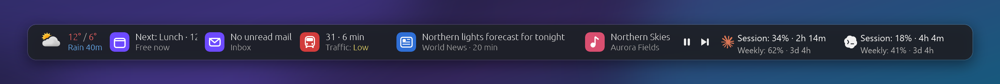

# BetterTaskbar

Small widgets for the empty space on your Windows 11 taskbar: the weather and
when the rain starts, your next calendar event, unread mail, the track that is
playing, the next bus from your stop, news headlines, and how much of your AI
coding plan is left. They have no background of their own, so they take on
whatever color or effect your taskbar has.

[](https://github.com/mrk1987/bettertaskbar/actions/workflows/ci.yml)



I built this for my ultrawide monitor, whose taskbar was mostly empty space.
It started with the things I look up all day anyway: the weather from
Norway's sweetheart yr.no, my Proton calendar and mail (through Proton Mail
Bridge and my other project [iOxide](https://github.com/mrk1987/iOxide)), and
how much of my Claude and Codex plans is left. Then the bus from my stop got
a widget, courtesy of Entur, the reason every Norwegian knows the bus is three
minutes late before the driver does. Then the news, then the music. If your taskbar has room to spare, some of these will
probably earn a spot on yours too.

## Widgets

| Widget | Shows | Double-click |
| --- | --- | --- |
| [Weather](docs/weather.md) | Yr symbol, the next 24 hours' high and low, and when rain, sleet or snow starts (`Rain 40m`, `Dry 6h`) | Opens the forecast on yr.no |
| [Calendar](docs/calendar.md) | What is on now and what is next, from any CalDAV server | Opens Proton Calendar |
| [Mail](docs/mail.md) | Unread count and the newest unread subjects, one at a time | Opens Proton Mail |
| [Now Playing](docs/now-playing.md) | Track and artist from Windows' media controls, with play/pause and next-track buttons | Brings up the player |
| [Next Departure](docs/departures.md) | The next bus, tram, metro, train or boat from a saved stop (`31 · 6 min`), and a None / Low / Medium / High traffic level for its route. Norway only, from Entur | Reads departures again |
| [News](docs/news.md) | Headlines in turn, with source and age, from built-in Norwegian, international and tech feeds or your own | Opens the headline on screen |
| [Usage](docs/dashboard.md) | Session and weekly use of Claude Code, Codex, Antigravity, OpenCode Go, Cursor, Grok Build or GitHub Copilot | Reads the usage again |

Weather, Calendar and Mail are on from the start. Weather needs nothing set
up. Calendar and Mail need an account: they were built for Proton through
iOxide and Proton Mail Bridge, but any CalDAV or IMAP server works. The other
widgets are off until you switch them on under **Widgets** in the dashboard.
Usage widgets reuse the sign-in of each tool's own app or CLI.

Text that does not fit its pill scrolls: it rests, slides left until the end
is in view, snaps back and starts over. News and Mail wait for a long
headline or subject to finish before showing the next.

Each widget's double-click action can be changed: open a URL, refresh its
data, launch an app, or open what it shows (the headline, the player). The
table lists the defaults.

Ideas for more widgets are welcome:
[open an issue](https://github.com/mrk1987/bettertaskbar/issues/new) and say
what you would like to see on your taskbar.

## Install

1. Download `bettertaskbar-<version>-windows-x64.zip` from the
   [latest release](https://github.com/mrk1987/bettertaskbar/releases/latest)
   and unzip it anywhere.
2. Run `bettertaskbar-widgets.exe`. A tray icon and the default widgets appear.

The program is not code-signed, so Windows SmartScreen warns the first time:
choose **More info**, then **Run anyway**. Each release lists the zip's
SHA-256. There is no installer. To start the widgets at sign-in, put a
shortcut in `shell:startup`. To update, quit from the tray icon and replace
the files; your settings are kept in `%APPDATA%\BetterTaskbar`.

Requires Windows 10 or 11. The dashboard window uses DirectX 12.

## Using it

- **Move:** press anywhere on a widget and drag. Near the taskbar it snaps
  into a free gap, never over Start, your app icons, the notification area or
  another widget. Release it there and it docks; release it anywhere else and
  it floats.
- **Order:** docked widgets keep the order you drop them in. On each side of
  the bar they pack together toward the edge ("magnetic"), and they move
  along when tray icons come and go or the resolution changes. Clear
  **Magnetic taskbar placement** under **General** in the dashboard to keep
  every widget at its exact spot instead.
- **Right-click a widget** to place, hide or set it up, or to change its
  double-click action. Weather also lists your saved places, Next Departure
  your saved stops.
- **Tray icon:** click it for the dashboard. Right-click it to switch any
  widget on or off (AI usage providers are in a submenu), to put every widget
  on the taskbar, on the desktop or floating on top, or to quit.

## Dashboard

Click the tray icon, or run `bettertaskbar-widgets.exe --dashboard`.

- **General:** the language (English or Norwegian bokmål; by default it
  follows Windows), magnetic placement, and putting every widget on the
  taskbar, on the desktop or floating at once.
- **Widgets:** switch each widget on or off, choose where it sits, and edit
  its theme.
- **Weather:** search for places, keep favorites, or enter coordinates.
- **Calendar / Mail:** enter CalDAV and IMAP settings and test them.
- **Now Playing:** the double-click action; there is nothing else to set.
- **Next Departure:** find a stop, keep several, and filter by line
  (`81, 87`) and by final destination (`Filipstad, Fornebu`). Choose whether
  road works and closures count toward the traffic level.
- **News:** switch the built-in feeds on or off, add any RSS or Atom feed,
  and set how fast headlines change, whether they pause under the mouse, and
  how old they may be.
- **Usage providers:** how often usage is read: every 5 (default), 10, 15 or
  30 minutes.
- **Theme Studio:** redesign any widget with text, icons, rectangles and
  progress bars bound to live data; import and export themes.

Everything is saved in `%APPDATA%\BetterTaskbar\widgets.json`. See the
[dashboard guide](docs/dashboard.md) and the
[configuration guide](docs/configuration.md).

## Privacy

- No telemetry. The widgets talk only to MET Norway and Yr (weather),
  Open-Meteo (place search), the CalDAV and IMAP servers you configure, the
  usage APIs of the providers you switch on, and, when those widgets are on,
  Entur and Statens vegvesen (departures and road situations) and the news
  feeds you choose.
- Now Playing reads Windows' media session on your PC, and controls it only
  when you press its buttons.
- Mail is opened read-only; nothing is marked as read.
- Calendar and mail passwords are stored as plain text in `widgets.json`.
  Keep that file private. Theme exports never include settings or passwords.

## Resource use

All widgets run inside the tray program and are drawn on the CPU. With all
eight widgets on (six plus Claude and Codex usage), the release build uses
about 31 MiB of RAM and 1.4 % of one CPU core.
`--process-per-widget` (or `"process_per_widget": true`) brings back the 1.0.0
design, one GPU process per widget, at about 55 MiB each. The measurements
are in [docs/architecture.md](docs/architecture.md#memory-and-cpu).

## Limits

- Only horizontal taskbars are dock targets.
- Text and icons are drawn for a dark taskbar.
- Next Departure covers Norway only. Vegvesen's open data does not say which
  hours a night closure applies to, so such closures count as Low at most,
  all day.
- Magnetic placement follows taskbar changes after a short delay; changes the
  shell does not announce can take up to 30 seconds.
- Revealing an auto-hidden taskbar with the mouse has not been checked
  ([#1](https://github.com/mrk1987/bettertaskbar/issues/1)).

## Troubleshooting

These print what a widget would show, or why it cannot. Pipe them to `more`,
since the program has no console of its own:

```sh
bettertaskbar-widgets.exe --check=calendar | more
bettertaskbar-widgets.exe --check=mail | more
bettertaskbar-widgets.exe --check=departures | more
bettertaskbar-widgets.exe --check=news | more
bettertaskbar-widgets.exe --check=now-playing | more
bettertaskbar-widgets.exe --check=taskbar | more
bettertaskbar-widgets.exe --check=docking | more
```

`--check=departures` also lists the destinations of the next departures,
which is handy for filling in the direction filter. Errors are logged to
`%APPDATA%\BetterTaskbar\widgets.log`.

## Build from source

With [Rust](https://rustup.rs) (stable):

```sh
git clone https://github.com/mrk1987/bettertaskbar.git
cd bettertaskbar/widgets
cargo run --release
```

How it works, including the approaches that failed, is in
[docs/architecture.md](docs/architecture.md). The banner above is drawn by the
widgets' own code from sample data; `docs/make_banner.py` explains how to
redraw it. Contributions: see [CONTRIBUTING.md](CONTRIBUTING.md).

## Credits

- Weather data from [MET Norway](https://api.met.no) (CC BY 4.0), icons from
  [Yr](https://www.yr.no).
- Stops and departures from [Entur](https://developer.entur.org), road
  situations from [Statens vegvesen](https://www.vegvesen.no), both under the
  [NLOD](https://data.norge.no/nlod/en/2.0) licence.
- Headlines belong to the publishers of the feeds you read.
- Docking, dragging, provider polling and dashboard styling follow or adapt
  [Claude Code Usage Monitor](https://github.com/CodeZeno/Claude-Code-Usage-Monitor)
  by CodeZeno (MIT). Full notices are in
  [THIRD_PARTY_NOTICES.md](THIRD_PARTY_NOTICES.md).

## License

[MIT](LICENSE)
